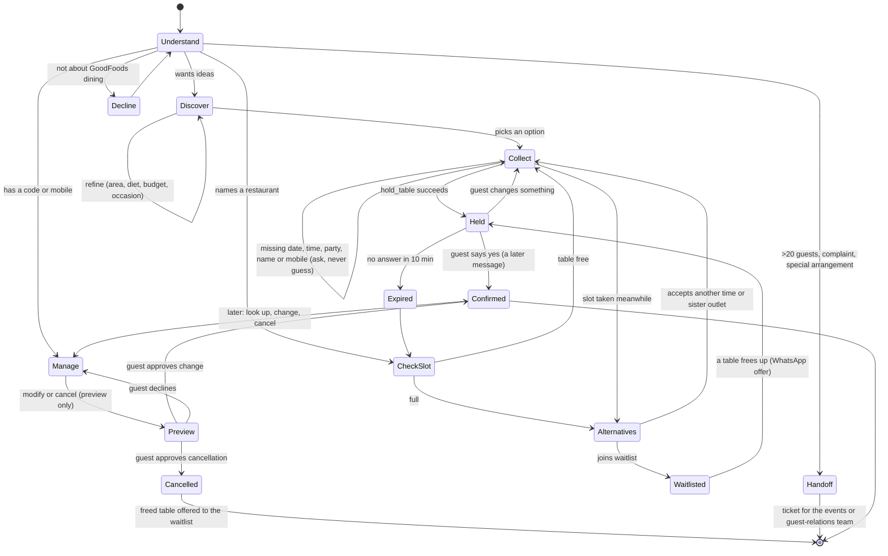
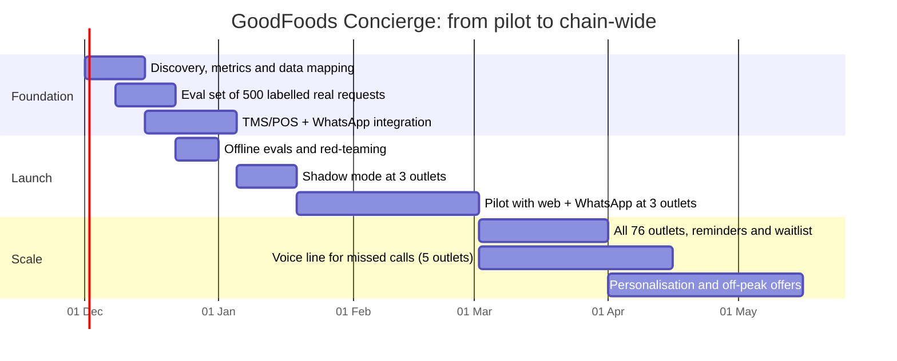

# GoodFoods Concierge: Use Case Document

> **One line:** an always-on, multilingual AI concierge that turns every "table for four tonight?" (web or
> WhatsApp today, phone and AI assistants next) into a confirmed GoodFoods booking in under a minute. When the
> first choice is full, it keeps the guest inside GoodFoods instead of losing them to a competitor.

| | |
|---|---|
| **Client** | GoodFoods: a Bengaluru restaurant group, 17 dining concepts across 76 outlets in 27 neighbourhoods (6,690 seats) |
| **Built** | A working agent (Llama-3.1-8B, from scratch, MCP), live table inventory, ops dashboard, ROI model, evals; see the [README](../README.md) |
| **Template** | Sections 1–7 follow the assignment template. Sections 8–14 add the business-strategy questions in the brief. |

---

## 1. Goal

Make booking a GoodFoods table **instant, multilingual and always successful**:

- Answer every booking request in **seconds, 24×7**, wherever the guest already is.
- **Never just say "sorry, we're full":** recover the guest with another time, a sister outlet nearby, or the waitlist.
- Remove the phone and WhatsApp load from hosts during the 7–10 PM rush, so they can look after the guests in front of them.

### Long Term Goal

Become GoodFoods' **AI front-of-house**: one conversational layer over the reservation book, guest profiles and
demand data that

1. **Books, changes, waitlists and reminds** across web, WhatsApp, voice and third-party AI assistants;
2. **Routes demand across the 76-outlet network** (and across the clock) to fill seats that would otherwise go empty;
3. **Owns the guest relationship directly** (preferences, occasions, allergies) instead of renting it from aggregators;
4. **Turns conversations into management intelligence**: where we turn people away, what they ask for that we
   don't serve, and when to staff up. That feeds menu, capacity and *where to open the next outlet*.

Then productise it as a **reservations layer for any capacity-constrained, multi-location business** (§10).

### Success Criteria

*What will make this bot successful.* Targets apply to the pilot (3 outlets, 6 weeks) and then to the chain-wide rollout.

| # | Metric | Definition | Pilot | Scale |
|---|---|---|---|---|
| 1 | **Booking conversion** | Conversations with booking intent that end in a confirmed booking | ≥ 45% | ≥ 55% |
| 2 | **Recovered covers** | Guests booked at another time, a sister outlet or via the waitlist after their first choice was full | measure baseline | ≥ 1 / outlet / day *(break-even ≈ 0.4, §9)* |
| 3 | **Containment** | Conversations completed without a human | ≥ 75% | ≥ 85% |
| 4 | **Unsafe actions** | Bookings confirmed without explicit guest approval; invented names or numbers | **0 (release gate)** | **0** |
| 5 | **Booking accuracy** | Audited bookings with the wrong date, time, party size or outlet | < 1% | < 0.3% |
| 6 | **Time to book** | First message to confirmation code, median | < 2 min | < 60 s |
| 7 | **Reply latency** | p90 per turn (hosted 8B inference) | < 5 s | < 3 s |
| 8 | **No-shows** | No-show rate on concierge bookings vs phone bookings | −20% | −35% |
| 9 | **Guest CSAT** | Post-visit WhatsApp rating (1–5) | ≥ 4.3 | ≥ 4.5 |
| 10 | **Unit cost** | All-in running cost per conversation (LLM + messaging + platform) | < ₹10 | < ₹5 |

---

## 2. Use case

*In about 100 words:*

> GoodFoods guests chat with the concierge (web today; WhatsApp and voice next) in English, Hindi or Hinglish,
> for example *"romantic Italian for two in Indiranagar, Saturday 8 PM"*. The agent understands the request, checks
> live table inventory across all 76 restaurants and recommends up to three options, each with reasons. It then holds
> a table, and only after the guest approves the summary does it issue a confirmation code and a WhatsApp
> confirmation. If a slot is full it offers another time, a sister outlet nearby or the waitlist. Guests can look up,
> change or cancel bookings; large events go to a human. Managers watch demand, recovered covers and agent quality
> on a live dashboard.

---

## 3. Key Steps (Bot flow)

*The flow from the guest's point of view.*

| Step | What the guest does | What the concierge does |
|---|---|---|
| 1. **Ask** | *"kal raat 8 baje 4 logon ke liye biryani, Frazer Town"* | Understands cuisine, area, date ("kal" = tomorrow), time and party size, in any language. Never asks twice for something already said. |
| 2. **Choose** | Reads up to 3 options | Each option shows rating, price, distance, *why it fits* (occasion, diet, quieter at that time) and **live availability**. |
| 3. **Recover** | Their first choice is full | Offers the closest free time there, sister outlets with a table at the same time, or the waitlist, as one-tap options. |
| 4. **Identify** | Gives name and mobile, once | Recognises returning guests ("welcome back"). Never guesses a name or number. |
| 5. **Review** | Sees a summary: table **held for 10 min** | Nothing is booked yet. The guest gets a clear "Shall I confirm?". |
| 6. **Confirm** | Says "yes" | Issues a code (e.g. `GF-7KQ2X`), sends a WhatsApp confirmation and offers *Add to calendar*. |
| 7. **Manage** | "Move it to 9" / "cancel GF-7KQ2X" | Previews the change and applies it only after a yes. A cancelled table is instantly offered to the waitlist. |
| 8. **Escalate** | "Office party for 40" / a complaint | Opens a call-back ticket for the events or guest-relations team, with the details already captured. |

---

## 4. State Transition Diagram

Two transitions are **enforced in code, not only in the prompt**. `Held → Confirmed` and `Preview → Confirmed/Cancelled`
require a *new* guest message: the MCP server declares the rule in tool metadata, and the agent's policy engine
blocks or downgrades violations. `Collect → Held` requires the name and mobile to appear in what the guest actually
typed.

---

## 5. Bot Features

### Key specifications that the customer cares about

- **It always books correctly:** right outlet, date, time and party size, every time. Two-step confirmation and code-level checks prevent wrong or unapproved bookings.
- **It doesn't lose guests:** a sold-out slot comes back with ranked alternatives (sister outlets first, so the brand and menu stay the same).
- **Speaks like Bengaluru does:** English, Hindi, Hinglish, Indian date words ("kal", "parso", "shanivar") and Indian formats (dd/mm, ₹, IST).
- **Fast:** under 3 s per turn on hosted 8B inference; booking in under a minute.
- **Safe by design:** no payments or card details in chat, no invented details, PII redacted in logs (DPDP Act 2023), human hand-off.
- **Transparent:** every decision is traceable (the agent trace in the UI, telemetry in the dashboard).

### KBs

| Knowledge base | Content | How the bot uses it |
|---|---|---|
| Restaurant catalogue | 76 outlets: concept, cuisine, area, address, geo, hours, price, rating, features, dietary options, signature dishes, **table inventory** | MCP tools (search, details, availability) and resource `goodfoods://restaurants/{id}` |
| Policies | Booking window, holds, cancellation, groups, allergies, dress code | MCP resource `goodfoods://policies` and the `concierge_brief` prompt |
| Reservation book | Live bookings, holds, waitlist, call-backs | SQLite via the booking service (a TMS/POS integration in production) |
| Guest profiles | Visits, preferences, notes (consented) | Returning-guest personalisation on hold |
| *Next:* menus and allergens, FAQ | Dish-level allergens, parking, accessibility detail | Retrieval tool (RAG) over menu and allergen sheets |

### Does it need Tools?

**Yes.** Ten tools, exposed over **MCP** by the GoodFoods server. The LLM chooses which to call; nothing is routed
by keywords.

| Tool | Purpose | Safety |
|---|---|---|
| `search_restaurants` | Recommend venues with reasons and live availability | read-only |
| `get_restaurant_details` | Hours, features, diet, dishes, private dining | read-only |
| `check_availability` | Is there a table? If not: other times, sister outlets, waitlist | read-only |
| `hold_table` | Booking step 1: hold for 10 min | name and mobile must come from the guest |
| `confirm_reservation` | Booking step 2: issue the code | only in a *later* turn than the hold |
| `get_reservation` | Look up by code or mobile | exact match only |
| `modify_reservation` | Change date, time, party or requests | preview, then confirm |
| `cancel_reservation` | Cancel; re-offer the table to the waitlist | preview, then confirm |
| `join_waitlist` | Join the waitlist for a full slot | name and mobile from the guest |
| `request_callback` | Human hand-off (events > 20, complaints) | name and mobile from the guest |

### Which Languages

| Now (text) | Next (voice and text) |
|---|---|
| English, Hindi (Devanagari), Hinglish (code-mixed). The server parses Hindi and Kannada date words (*kal, parso, shanivar, naale*). | Kannada, Tamil, Telugu, Marathi. Indic speech recognition and TTS (e.g. Sarvam's speech models) for a phone line that answers the calls hosts miss at peak. |

### Any new features asked for?

Beyond "take a reservation", this build adds: **explainable recommendations**, **sold-out recovery across the
network**, **holds with two-step confirmation**, **waitlist with automatic backfill on cancellation**, **human
hand-off tickets**, **add-to-calendar**, simulated **WhatsApp confirmations**, a **manager dashboard** (demand
heatmap, channel mix, no-shows, AI funnel, guardrail activity, unmet-demand signals) and an **ROI model**.

### Difficulty (🟢 Green, 🟡 Yellow, 🔴 Red)

| Feature | Difficulty | Why | Status |
|---|---|---|---|
| Search and recommend (cuisine, area, diet, occasion, budget) | 🟢 | Structured data plus transparent scoring | ✅ Built |
| Live availability and table allocation (joined tables, private rooms) | 🟡 | Concurrency, holds, no double booking | ✅ Built |
| Hold → confirm with code-level safety | 🟡 | Small models confirm prematurely | ✅ Built (policy engine) |
| Modify, cancel, waitlist with backfill | 🟡 | State consistency, notifications | ✅ Built |
| Hindi and Hinglish text, relative dates | 🟡 | Code-mixing; "kal" is ambiguous | ✅ Built |
| Human hand-off with context | 🟢 | Ticketing | ✅ Built (simulated queue) |
| Ops dashboard and demand signals | 🟢 | Analytics on logs | ✅ Built |
| WhatsApp channel | 🟡 | BSP onboarding, template approval, opt-in | Roadmap |
| Real-time TMS/POS sync | 🔴 | Vendor APIs, walk-ins, one source of truth | Roadmap |
| Vernacular voice on phone lines | 🔴 | ASR on noisy calls, names and numbers, latency | Roadmap |
| Deposits for large groups and tasting menus | 🔴 | Payments, refunds, RBI e-mandate rules | Hand-off for now |
| Personalised offers, off-peak nudges, forecasting | 🔴 | Data science plus pricing policy and consent | Roadmap (signals already logged) |

### What integrations are needed

| Integration | Why | Priority |
|---|---|---|
| Table management / POS (the group's existing TMS or POS) | Real inventory, walk-ins, check-ins, no-show truth | P0 |
| WhatsApp Business Platform (via a BSP) | Main channel in India: confirmations, reminders, waitlist offers | P0 |
| Hosted inference for the 8B model (Groq, or vLLM on a GPU) | Sub-3 s turns at scale | P0 |
| Telephony / IVR + Indic ASR/TTS | Answer missed calls with voice | P1 |
| CRM / CDP | Guest profiles, consent, marketing | P1 |
| Aggregator and *Reserve with Google* feeds | One inventory across channels (prevent double booking) | P1 |
| Payment gateway | Deposits for large groups (later) | P2 |
| Data warehouse and BI, staff SSO | Reporting, dashboard access | P2 |

---

## 6. Scale up / Rollout Strategy

*A reasonable way to test and roll this out.*

| Phase | When | What | Exit gate |
|---|---|---|---|
| **0. Discovery** | Weeks 1–2 | Shadow 3 outlets' phone and WhatsApp lines; label **500 real requests** into an eval set (with Hinglish); map TMS/POS APIs; agree on metrics | Signed-off metrics and data access |
| **1. Offline evals & red-team** | Weeks 2–4 | Replay the 500 conversations against the agent ([our harness](EVALS.md)); adversarial set (prompt injection, invented details, early confirmation) | ≥ 90% task success, **0 unsafe actions** |
| **2. Shadow mode** | Weeks 5–6 | The agent drafts each reply; a host approves it in a staff console. Measure the edit rate. | < 10% of replies edited |
| **3. Pilot** | Weeks 7–12 | 3 contrasting outlets (high-demand Indiranagar, family Jayanagar, office-lunch Whitefield); web + WhatsApp; **A/B by time block** to measure incrementality; kill switch; hand-off SLA | Conversion ≥ 45%, recovered covers above break-even, CSAT ≥ 4.3 |
| **4. Chain-wide** | Months 4–5 | All 76 outlets; reminders and waitlist on; voice for missed calls at 5 busy outlets | Same metrics across outlets |
| **5. Optimise & open up** | Month 6+ | Personalisation, off-peak offers, forecasting; expose the MCP endpoint to partners (hotel concierges, corporate travel desks, consumer AI assistants) | Revenue per available seat-hour ↑ |

**Running it safely:** evals run in CI on every prompt or tool change; prompts and tools are versioned; canary by
outlet; dashboards alert on containment, conversion and any unsafe-action event; weekly transcript review with
outlet managers; one-click rollback to the previous prompt or model.

---

## 7. Key Challenges

| Challenge | Why it is hard | Mitigation (built or planned) |
|---|---|---|
| **Small-model reliability** | 8B models invent restaurants and contact details, confirm too early, and mangle arguments | Measured reliability layer: argument repair, provenance checks, server-declared two-step policies, reply verifier. Evals show the effect (see [EVALS.md](EVALS.md)). |
| **Inventory truth** | Walk-ins, aggregator bookings and staff merging tables diverge from the book | TMS/POS as the single source of truth; short holds; conflict alerts; capacity buffers for walk-ins |
| **Latency on cheap infrastructure** | A local 8B on a laptop takes 15–30 s per turn | Hosted inference (Groq / vLLM) for < 3 s; stable prompt prefixes for KV-cache reuse; concise tool schemas |
| **Language and voice** | Code-mixing, relative dates, names and numbers over noisy phone lines | Deterministic date and time parsing on the server; read-back confirmation; Indic ASR tuned for numbers |
| **No-shows and deposits** | Payments, refunds, regulation | Reminders, one-tap cancel, waitlist backfill now; deposits for big groups via a human, then a gateway |
| **Privacy (DPDP Act 2023)** | Phone numbers, preferences, consent for marketing | PII redaction in telemetry (built), consent capture, retention limits, data stays in India |
| **Change management** | Hosts must trust the bot; incentives favour phones | Shadow mode, a staff console, hand-off SLAs, outlet-level leaderboards for recovered covers |
| **Abuse** | Prompt injection; bots holding all tables | Exact-match lookups only, holds expire in 10 min, rate limits per number |
| **Proving incrementality** | Seasonality and marketing muddy attribution | A/B by time block and outlet; an attribution haircut in the ROI model |

---

## 8. Business problems & non-obvious opportunities

The obvious problem is *answering booking requests*. The bigger problems sit around it:

1. **The sold-out leak (the biggest lever).** When outlet A is full, a guest usually leaves for a competitor, even
   though sister outlet B, three kilometres away, has empty tables. A chain's inventory is *fungible*, but today it
   is sold as 76 separate islands. The concierge treats it as **one network** and reroutes overflow. Recovered covers
   are measurable revenue that a single-venue booking widget can't capture and an aggregator has no incentive to
   capture.
2. **Peaks and troughs.** Friday and Saturday 8–10 PM sell out while Tuesday at 3 PM sits empty (see the dashboard
   heatmap). Because every request is seen, the bot can nudge across the clock: *"7:15 is free and quieter"* today,
   off-peak offers tomorrow. That is yield management without price wars.
3. **Missed demand at the edges.** Calls ring out during the rush and late-night WhatsApps go unanswered. Each one is
   a lost booking that a 24×7 agent recovers at near-zero marginal cost.
4. **Aggregator dependency.** Platform fees per cover, and the platform owns the guest. A direct conversational
   channel shifts repeat guests to first-party bookings and builds GoodFoods' own guest data: occasions, allergies,
   favourite outlets.
5. **No-shows are hidden inventory.** Reminders with one-tap cancel convert silent no-shows into early
   cancellations, and **waitlist backfill** (built) resells the freed table automatically.
6. **Unmet demand is market research.** Every "no match" and every "full" is logged with area and cuisine (dashboard,
   *Expansion signals*). *"Japanese in HSR Layout: 40 requests last month, nearest outlet 7 km"* is evidence for
   **where to open the next outlet**, which concept to add, and which nights need more covers. The concierge works as
   a market-research engine.
7. **Events are the highest-value leads, and they leak.** Office parties and birthdays for 20–100 people arrive by
   phone and get lost. Structured capture plus a call-back SLA gives the events team a pipeline.
8. **Agentic commerce: being bookable by AI assistants.** Guests increasingly ask an assistant to *"book dinner near
   me"*. Because the booking brain is an **MCP server**, general-purpose AI assistants, hotel concierge bots or a
   corporate travel agent can book GoodFoods directly. This is a new distribution channel, comparable to SEO in the
   AI era.
9. **Staffing and prep from the forward book.** Bookings, holds and waitlist depth predict covers by outlet and
   hour, which helps rosters and prep lists and cuts food waste.

---

## 9. Success metrics & ROI

**North-star metric:** *recovered covers per outlet per day.* These are guests who would have been lost (missed
request or full slot) but were booked by the concierge.

**ROI model** (live and editable on the app's *ROI model* page). All inputs are **assumptions** for a mid-market
Bengaluru chain, to be replaced with GoodFoods' data in Discovery:

| Assumption | Value | | Assumption | Value |
|---|---|---|---|---|
| Outlets | 76 | | Avg party / spend per cover | 2.8 / ₹750 |
| Booking requests / outlet / day | 30 | | Contribution margin on an extra cover | 40% |
| Requests lost today (missed calls, late replies) | 10% | | No-show rate: today → with reminders | 8% → 5% |
| …of which the concierge converts | 50% | | Freed tables resold | 50% |
| Requests hitting a full slot | 10% | | Aggregator share / shifted direct / fee per cover | 30% / 15% / ₹50 |
| Saved by staff today → by the concierge | 15% → 35% | | Requests handled end to end; staff minutes saved per request | 60%; 3 min @ ₹200/h |
| LLM / messaging cost per conversation | ₹0.15 / ₹0.60 | | Platform & support / one-time build | ₹2.5 L/month / ₹20 L |
| **Attribution confidence** (haircut on all benefits) | **50%** | | | |

**Monthly result (after the 50% haircut):**

| Benefit line | ₹ / month | | Cost line | ₹ / month |
|---|---|---|---|---|
| Recovered lost requests | 14.4 L | | LLM inference (41k conversations) | 0.06 L |
| Full slots rerouted | 5.7 L | | Messaging | 0.25 L |
| No-shows resold | 3.9 L | | Platform & support | 2.5 L |
| Aggregator fees avoided | 1.9 L | | | |
| Staff time freed | 2.1 L | | | |
| **Total benefit** | **28.0 L** | | **Total running cost** | **2.8 L** |

- **Net benefit ≈ ₹25 L / month · ~10× return on running cost · build cost paid back in under a month.**
- **Break-even ≈ 0.4 extra covers per outlet per day.** Less than one guest per restaurant per day pays for
  everything; the model projects about 3.5.
- **Stress test:** cut the haircut to 20% *and* halve the capture rate, and the return is still **about 3×**.
- **What the numbers say:** at 8B-model prices, inference is a rounding error (₹6k a month for 41k conversations).
  The case rests on recovering a fraction of one table per outlet per day, not on staff cuts.

**Leading indicators to track weekly:** conversion, containment, recovered covers, unsafe-action count (must be 0),
median time to book, p90 latency, no-show rate by channel, CSAT, hand-off SLA, and unmet demand by area × cuisine.

---

## 10. Vertical expansion

**The abstraction:** any business that sells *capacity-constrained, time-slotted resources across locations, matched to
preferences under policies*. In this design **the agent is domain-agnostic**. The domain lives in the MCP server: its
tools, its `concierge_brief` prompt, and its policies declared in tool metadata. A new vertical is a new MCP server,
catalogue and eval set; the agent, guardrails, UI, telemetry and evals are reused.

| Vertical | "Table" | "Party size" | Recommendation signal | Special policy | Fit |
|---|---|---|---|---|---|
| Other restaurant groups and franchises | Tables | Covers | Cuisine, occasion, distance | Deposits for tasting menus | 🟢 Same product, new catalogue |
| QSR and cloud kitchens | Pickup or dine-in slots | Orders | ETA, outlet load | Prepayment | 🟢 |
| Salons and spas | Stylist chair × service | Service length | Stylist skill, gender preference | Deposits for long services | 🟢 |
| Fitness studios | Class capacity | 1 | Class type and level | Late-cancel fee, waitlist | 🟢 |
| Entertainment (bowling, gaming, escape rooms) | Lanes, rooms | Group | Age, theme | Group deposits | 🟢 |
| Co-working and meeting rooms | Room × hours | Attendees | AV, location | Corporate billing | 🟢 |
| Hotels (F&B, spa, rooms) | Tables, therapists, rooms | Guests | Packages | Charge to room | 🟡 |
| Auto service centres | Bay × technician | Vehicle | Service type | Pick-up and drop | 🟡 |
| Banquets and events | Halls | Guests | Budget, cuisine | Contracts, so a human closes | 🟡 |
| Clinics and diagnostics | Doctor or lab slot | Patient | Specialty, distance, insurance | Consent, no medical advice, regulation | 🔴 Partner-led |

**Go-to-market sequence:** GoodFoods as design partner (proof of recovered covers) → 5–10 Bengaluru restaurant groups
on the same product, white-labelled → multi-city → salons and fitness (same mechanics, different catalogue) → hotels
and auto services → regulated verticals with partners. **Pricing hypothesis:** a per-outlet subscription plus a small
success fee per recovered cover, which aligns our revenue with the client's north star.

---

## 11. Competitive advantages

1. **Network-aware demand routing.** Single-venue widgets optimise one listing, and aggregators optimise their own
   marketplace (and will happily send the guest to a competitor). This concierge treats a group's outlets as **one
   inventory**: overflow goes to sister outlets first (same brand, same menu) and to quieter times next. The result,
   recovered covers, is measurable and belongs to the client.
2. **Small-model economics with large-model reliability.** An open 8B model costs about **₹0.05–0.15 per
   conversation**, can be self-hosted in India (data residency, no lock-in), and is fast enough for voice. A
   measured reliability layer makes it trustworthy: server-declared two-step commits, provenance checks on PII,
   argument repair, and a reply verifier. Cheap enough to answer every request on every channel; safe enough to let
   it confirm bookings.
3. **Protocol-native (MCP): build once, serve every channel.** The reservation brain is a standard MCP server. The same
   tools serve the web chat, a WhatsApp bot, a voice line, a staff console, partner agents and consumer AI
   assistants. A new channel is configuration, and a new vertical reuses the agent. It is ready for agentic
   commerce today.

*Also:* India-first by default: Hinglish, Indian date words, ₹, IST, a WhatsApp-first channel plan, and a
DPDP-aware data design.

---

## 12. Stakeholders

| Stakeholder | Role | What they need |
|---|---|---|
| CEO / COO | Sponsor | Revenue uplift, brand protection |
| Head of Guest Experience / Revenue | Business owner (accountable) | Conversion, recovered covers, CSAT |
| Outlet GMs and hosts | Daily users | Fewer calls at peak, accurate books, easy overrides |
| Call centre / reservations desk | Hand-off receivers | Context-rich tickets, clear SLAs |
| Marketing / CRM | Consumers of guest data | Consented profiles, occasion triggers |
| IT / Data | Integrations, security | TMS/POS APIs, uptime, observability |
| Finance | ROI sign-off | Incrementality evidence (A/B) |
| Legal / Compliance | DPDP, consent, retention | Data map, redaction, audit trail |
| Guests | End users | Speed, accuracy, their language, no spam |
| Vendors (WhatsApp BSP, TMS/POS, inference provider) | Suppliers | Clear API contracts and volumes |

## 13. Potential customers

- **Multi-outlet restaurant groups** in Indian metros (10–200 outlets): casual dining, bars and microbreweries,
  family dining, fine dining (deposits, tasting menus).
- **Franchise operators** running several brands in a city (the GoodFoods shape).
- **Hotel F&B** (multiple outlets per property) and **mall or food-district operators**.
- **Adjacent capacity businesses** from §10: salon chains, fitness studios, entertainment centres, co-working.
- **Platforms** that want an MCP-native booking layer for their own AI assistants (travel, corporate, concierge).

## 14. Implementation timeline

---

### Assumptions behind this document

- GoodFoods' profile (17 concepts, 76 outlets in Bengaluru, table mixes, ratings and prices) is **synthetic**,
  generated for the assignment, as are the five weeks of booking history used by the dashboard.
- ROI inputs are directional industry-style assumptions, **not** GoodFoods data; every input is editable in the app.
- WhatsApp messages, call-back queues and the waitlist offer flow are simulated; production would use the integrations in §5.
